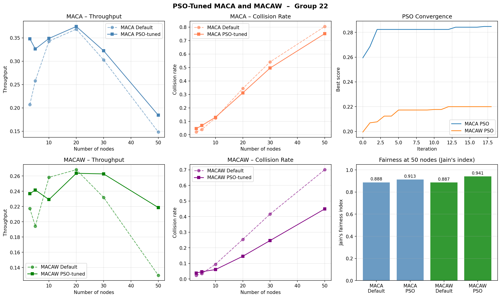

# PSO-Tuned MACA and MACAW Protocols

**Network and Design Organisation (NDO) – 7th Semester Project**  
**Group 22**  
- **Jay Hirapara**  
- **Darshit Khandelwal**  
- **Kundan Meena**  

---

## 📌 Project Overview

Medium Access Control (MAC) protocols such as **MACA** (*Multiple Access with Collision Avoidance*) and **MACAW** (*MACA for Wireless LANs*) govern channel contention in wireless networks using Request-to-Send / Clear-to-Send (RTS/CTS) handshakes and random backoff contention windows.

Historically, backoff parameters (such as minimum contention window $CW_{min}$, maximum contention window $CW_{max}$, collision multiplicative growth factor $f$, and success decrease step $d$) were engineered using static heuristic rules (e.g., standard Binary Exponential Backoff). While these rules perform adequately in small networks, they lead to severe channel contention and high collision rates in congested, dense wireless networks.

In this project, we formulate the contention window parameter selection as a continuous multi-objective optimization problem and employ **Particle Swarm Optimization (PSO)** to discover optimal backoff settings that maximize throughput and fairness while penalizing collision rates.

---

## ⚙️ PSO Optimization Framework

### 1. Objective Function (Fitness Score)
$$\text{Score} = \text{Throughput} \times \text{Fairness} - 0.1 \times \text{CollisionRate}$$

- **Throughput:** Fraction of simulation slots carrying successful transmissions.
- **Fairness:** Jain's Fairness Index across all active nodes:
  $$\mathcal{J}(x) = \frac{\left(\sum_{i=1}^n x_i\right)^2}{n \sum_{i=1}^n x_i^2}$$
- **Collision Penalty:** $0.1 \times \text{CollisionRate}$, ensuring throughput and fairness remain primary while discouraging excessive retries.

### 2. PSO Hyperparameters
- **Inertia Weight ($w$):** `0.7`
- **Cognitive Parameter ($c_1$):** `1.5`
- **Social Parameter ($c_2$):** `1.5`
- **Stability Criterion:** $c_1 + c_2 = 3.0 < 3.5$, guaranteeing swarm convergence without divergence/explosion (Clerc & Kennedy, 2002; Poli, 2009).
- **Swarm Size:** `16 particles`
- **Iterations:** `18 iterations` ($16 \times 18 = 288$ evaluations per protocol)
- **Training Network Sizes:** `[2, 8, 20, 40]` nodes
- **Testing Network Sizes:** `[3, 5, 10, 20, 30, 50]` nodes (unseen validation)

---

## 🔬 Optimized Parameters

| Protocol | $CW_{min}$ | $CW_{max}$ | Growth Factor ($f$) | Shrink Step ($d$) |
| :--- | :---: | :---: | :---: | :---: |
| **Default (BEB)** | 4 | 32 | 2.00 | 1.00 |
| **MACA (PSO-Tuned)** | **3** | **36** | **2.47** | **4.00** |
| **MACAW (PSO-Tuned)** | **7** | **52** | **1.35** | **1.27** |

> **Insight:** PSO identifies that congested wireless networks benefit from wider upper bounds ($CW_{max}$ expanded to 36 and 52) to disperse nodes after collisions. For MACAW, PSO chooses a gentler collision expansion factor ($1.35$ vs $2.00$) aligned with the MILD (Multiplicative Increase, Linear Decrease) design philosophy.

---

## 📊 Experimental Results

### 1. Performance at 50 Nodes (High Congestion)

| Metric | MACA Default | MACA PSO | Δ (Change) | MACAW Default | MACAW PSO | Δ (Change) |
| :--- | :---: | :---: | :---: | :---: | :---: | :---: |
| **Throughput** | 14.8% | **18.4%** | **+24.3%** | 13.0% | **21.9%** | **+68.4%** |
| **Collision Rate** | 80.4% | **75.1%** | **-5.3%** | 70.1% | **44.9%** | **-25.2%** |
| **Fairness (Jain's)** | 0.888 | **0.914** | **+2.9%** | 0.887 | **0.941** | **+6.1%** |

### 2. Comprehensive Scaling Across Network Sizes

#### MACA Results
| Nodes | Default Thr | PSO Thr | Δ Thr (%) | Default Coll | PSO Coll | Default Fair | PSO Fair |
| :---: | :---: | :---: | :---: | :---: | :---: | :---: | :---: |
| **3** | 0.2073 | 0.3483 | +68.0% | 0.0203 | 0.0456 | 0.9602 | 0.8293 |
| **5** | 0.2582 | 0.3263 | +26.4% | 0.0393 | 0.0688 | 0.9904 | 0.9188 |
| **10** | 0.3430 | 0.3489 | +1.7% | 0.1247 | 0.1300 | 0.9935 | 0.9819 |
| **20** | 0.3687 | 0.3745 | +1.6% | 0.3440 | 0.3117 | 0.9804 | 0.9841 |
| **30** | 0.3029 | 0.3225 | +6.5% | 0.5413 | 0.4957 | 0.9701 | 0.9635 |
| **50** | 0.1484 | 0.1845 | **+24.3%** | 0.8044 | 0.7511 | 0.8876 | 0.9135 |

#### MACAW Results
| Nodes | Default Thr | PSO Thr | Δ Thr (%) | Default Coll | PSO Coll | Default Fair | PSO Fair |
| :---: | :---: | :---: | :---: | :---: | :---: | :---: | :---: |
| **3** | 0.2174 | 0.2368 | +8.9% | 0.0239 | 0.0383 | 0.7387 | 0.7723 |
| **5** | 0.1943 | 0.2417 | +24.4% | 0.0342 | 0.0466 | 0.9940 | 0.5882 |
| **10** | 0.2583 | 0.2291 | -11.3% | 0.0944 | 0.0602 | 0.9943 | 0.9072 |
| **20** | 0.2683 | 0.2636 | -1.8% | 0.2539 | 0.1456 | 0.9869 | 0.9825 |
| **30** | 0.2320 | 0.2628 | +13.3% | 0.4163 | 0.2465 | 0.9606 | 0.9764 |
| **50** | 0.1299 | 0.2187 | **+68.4%** | 0.7008 | 0.4493 | 0.8867 | 0.9411 |

---

## 📈 Visual Results

All simulation graphs are automatically saved as `results.png` after execution:



---

## 🚀 How to Run

### Prerequisites
- Python 3.8+
- NumPy
- Matplotlib

Install required packages:
```bash
pip install numpy matplotlib
```

### Execution
Run the complete PSO optimization and evaluation pipeline:
```bash
python pso_maca_macaw.py
```

The script will:
1. Execute PSO optimization for MACA and MACAW (18 iterations with live progress).
2. Evaluate default vs. PSO parameters on unseen node sizes across multiple random seeds.
3. Print formatted comparison tables and summary metrics in the terminal.
4. Export high-resolution comparison plots to `results.png`.

---

## 📁 Repository Structure
```
.
├── pso_maca_macaw.py      # Core simulation and PSO optimization pipeline
├── NDO_final.pptx         # Presentation slides (with real data & charts)
├── results.png            # Generated evaluation plots
├── README.md              # Project documentation and summary
└── .gitignore
```

---

## 📚 References
1. Kennedy, J., & Eberhart, R. (1995). *Particle swarm optimization*. Proceedings of IEEE International Conference on Neural Networks (ICNN).
2. Shi, Y., & Eberhart, R. (1998). *A modified particle swarm optimizer*. IEEE International Conference on Evolutionary Computation.
3. Clerc, M., & Kennedy, J. (2002). *The particle swarm: explosion, stability, and convergence in a multidimensional complex space*. IEEE Transactions on Evolutionary Computation, 6(1), 58-73.
4. Poli, R. (2009). *Mean and variance of the sampling distribution of particle swarm optimizers during stagnation*. IEEE Transactions on Evolutionary Computation, 13(4), 712-721.
5. Bharghavan, V., Demers, A., Shenker, S., & Zhang, L. (1994). *MACAW: A media access protocol for wireless LANs*. ACM SIGCOMM Computer Communication Review, 24(4), 212-225.
6. Karn, P. (1990). *MACA - a new channel access method for packet radio*. ARRL/CRRL Amateur Radio 9th Computer Networking Conference.
7. Jain, R., Chiu, D. M., & Hawe, W. R. (1984). *A quantitative measure of fairness and discrimination for resource allocation in shared computer systems*. DEC Research Report TR-301.
